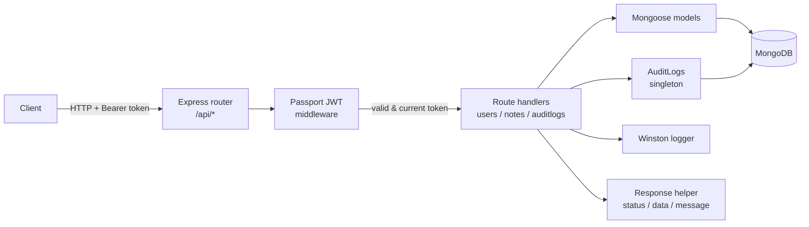

# Note Pad API

A REST API for an online notes app: users sign up, log in, and create, edit and delete their own notes from anywhere with an internet connection.

Built with **Node.js, Express and MongoDB (Mongoose)**, with JWT authentication, bcrypt password hashing, audit logging and structured logging.

---

## Features

- **User accounts** – register, log in and log out.
- **JWT authentication** – protected routes use Passport with a JWT Bearer strategy.
- **Single active session** – the latest token is stored on the user; a token from an older login is rejected, and logging out invalidates the token immediately.
- **Password hashing** – passwords are hashed with bcrypt (10 salt rounds) in a Mongoose `pre('save')` hook, so plain passwords are never written by the save flow.
- **Notes CRUD** – each user can only see, update and delete their own notes.
- **Bulk delete** – several notes can be deleted in one request.
- **Readable numeric IDs** – `userId` and `noteId` are auto-incremented numbers generated with a counter collection, instead of exposing MongoDB ObjectIds.
- **Audit logs** – create/update/delete actions are saved to MongoDB with the user's email, the area and the operation type, and can be queried by date range.
- **Structured logging** – Winston logger with timestamped, consistently formatted log lines.
- **Consistent responses** – every endpoint returns the same `{ status, data, message }` shape, and errors go through a custom error class.

## Tech Stack

| Area | Technologies |
|---|---|
| Runtime / framework | Node.js, Express |
| Database | MongoDB, Mongoose |
| Auth | Passport, passport-jwt, jwt-simple, bcrypt |
| Validation | validator, is_js |
| Logging | Winston, Morgan |
| Tooling | ESLint, dotenv |

## Architecture



### Project structure

```
api/
├── app.js                  # Express app setup and error handling
├── bin/www                 # HTTP server start + database connection
├── config/
│   ├── index.js            # Settings read from environment variables
│   └── Enum.js             # HTTP status codes, log levels, password length
├── db/
│   ├── Database.js         # Singleton MongoDB connection
│   └── models/             # User, Note, Counter, AuditLogs, TokenBlacklist
├── lib/
│   ├── auth.js             # Passport JWT strategy
│   ├── AuditLogs.js        # Writes audit records to MongoDB
│   ├── Error.js            # CustomError (status + data + message)
│   ├── Response.js         # Success / error response helpers
│   └── logger/             # Winston logger and wrapper class
└── routes/
    ├── index.js            # Loads every route file automatically
    ├── users.js
    ├── notes.js
    └── auditlogs.js
```

**Automatic route loading:** `routes/index.js` reads the `routes` folder and mounts each file under `/api/<file name>`. Adding a new route file is enough to expose a new group of endpoints – no manual registration needed.

### How authentication works

1. On register or login, the server creates a JWT containing the user's MongoDB id and an expiry time.
2. The token is saved on the user document as `currentToken` and returned to the client.
3. For protected routes, Passport verifies the token signature and expiry, loads the user, and checks that the token **matches `currentToken`**. Logging in on another device replaces it, so the previous token stops working.
4. On logout, `currentToken` is cleared and the token is also stored in a blacklist collection with a MongoDB TTL index, so the record deletes itself once the token would have expired anyway.

## Getting Started

### Requirements

- Node.js 18+
- A MongoDB database (local or MongoDB Atlas)

### Setup

```bash
cd api
npm install
```

Create a `.env` file in the `api` folder:

```env
PORT=3000
CONNECTION_STRING=mongodb://localhost:27017/notepad
JWT_SECRET=change-this-to-a-long-random-string
JWT_EXPIRE_TIME=86400      # token lifetime in seconds (default: 1 year)
```

Start the server:

```bash
npm start
```

The API is available at `http://localhost:3000/api`.

## API Reference

All responses use this format:

```json
{ "status": 200, "data": { }, "message": "Success" }
```

Protected endpoints need this header:

```
Authorization: Bearer <token>
```

### Users – `/api/users`

| Method | Endpoint | Auth | Description |
|---|---|---|---|
| POST | `/register` | – | Create an account and get a token. Body: `username`, `email`, `password` |
| POST | `/login` | – | Log in. Body: `email`, `password` (min. 8 characters) |
| POST | `/logout` | ✔ | Invalidate the current token |
| GET | `/get` | ✔ | List users |
| POST | `/create` | ✔ | Create a user. Body: `username`, `email`, `password` |
| POST | `/update` | ✔ | Update a user. Body: `userId` + any of `username`, `email`, `password` |
| POST | `/delete` | ✔ | Delete a user. Body: `userId` |

### Notes – `/api/notes`

All note endpoints require authentication and only affect the logged-in user's notes.

| Method | Endpoint | Description |
|---|---|---|
| GET | `/get-notes` | List your notes, most recently updated first |
| POST | `/create` | Create a note. Body: `content` (required), `title` (defaults to `"Untitled"`) |
| POST | `/update` | Update a note. Body: `noteId` + `title` and/or `content` |
| POST | `/delete` | Delete notes. Body: `noteIds` (array of numbers) |

### Audit logs – `/api/auditlogs`

| Method | Endpoint | Auth | Description |
|---|---|---|---|
| POST | `/` | ✔ | Query logs. Body (optional): `beginDate`, `endDate`, `skip`. Without dates, returns logs since the start of yesterday. Max 500 records per request, newest first. |

### Example

```bash
# Register
curl -X POST http://localhost:3000/api/users/register \
  -H "Content-Type: application/json" \
  -d '{"username":"ahmet","email":"ahmet@example.com","password":"secret123"}'

# Create a note
curl -X POST http://localhost:3000/api/notes/create \
  -H "Content-Type: application/json" \
  -H "Authorization: Bearer <token>" \
  -d '{"title":"Shopping","content":"Milk, bread, eggs"}'
```

## Roadmap

- Role-based access control so user management and audit log endpoints are limited to admins
- Request validation middleware (for example Joi or Zod) shared across routes
- Pagination for the notes list
- Automated tests with Jest and Supertest
- A client app (web or mobile) on top of this API

## Author

**Ahmet Özgül** – [GitHub](https://github.com/AhmetOzgul)
